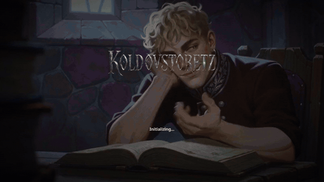
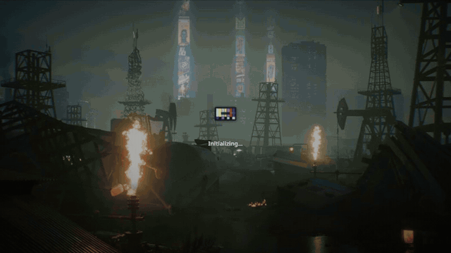
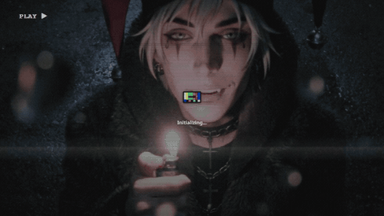
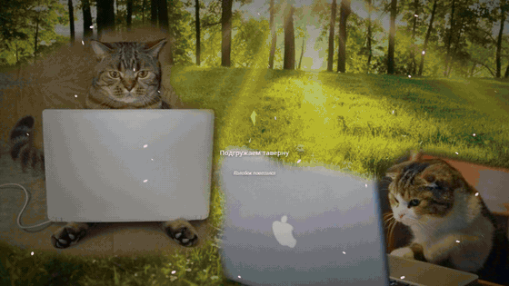
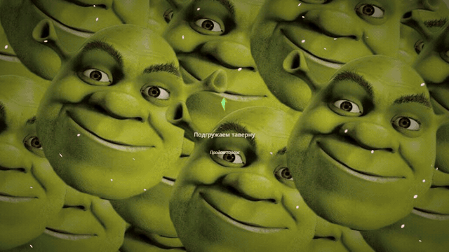
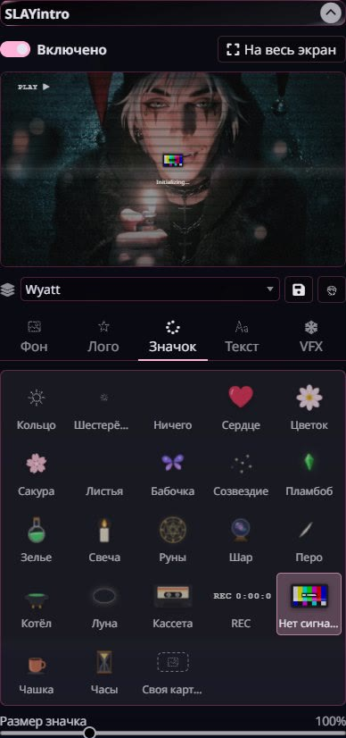
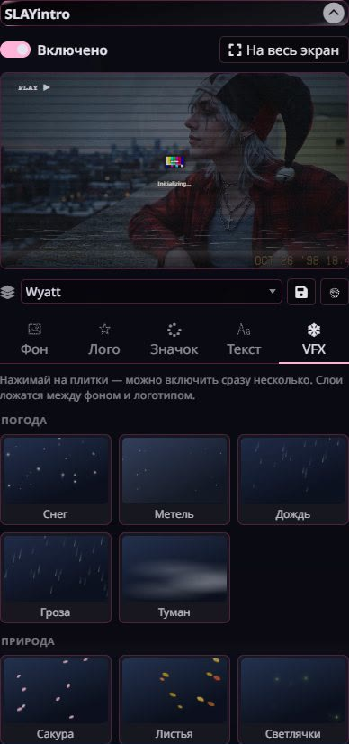

# SLAYintro

[Русская версия](README.ru.md)

A game-style loading screen for [SillyTavern](https://github.com/SillyTavern/SillyTavern). Instead of the Tavern logo and "Initializing", you get your own background (picture, video or slideshow), your own logo, a loading badge of your choice, rotating tips and effects on top: snow, rain, embers, old film. No music and no progress bar: something spins while the Tavern loads.











 

*Test versions for the beta, not the final look.*

The settings panel is in Russian.

## Installation

1. In SillyTavern, open **Extensions → Install extension**.
2. Paste this address and confirm:

   ```
   https://github.com/wewwaistyping/SLAYintro
   ```

3. Reload the page.

Tested on SillyTavern 1.19.0, on desktop and on a phone.

## How it works

The screen replaces itself on every launch. For the first second after the tab opens, the Tavern still shows its stock screen: extensions start only after it has read the settings, and nothing can step in earlier. From then on the screen is yours until loading ends.

Settings: **Extensions → SLAYintro**. A live preview sits at the top; click it for full screen. The switch in its corner shows how the screen looks on a computer and on a phone. Every change shows right away.

## Tabs

| Tab | What's inside |
|---|---|
| **Фон** (Background) | The theme's background, your own file (picture, GIF or video) or a slideshow of pictures with shuffle and a configurable interval. For pictures, a light animation: zoom, drift, breathe. Dimming. A separate light video for phones |
| **Лого** (Logo) | The Tavern logo, your own file or none. Size and animation: float, pulse, glow |
| **Значок** (Badge) | The loading badge: 23 to choose from, or your own picture |
| **Текст** (Text) | A line instead of "Initializing" and tips that take turns |
| **VFX** | Effects over the background; several at once, each with its own strength |

## Builds

A set of settings can be saved as a build and switched in the dropdown. Edits go straight into the selected build, and a line under the list reminds you which one. To make a new build, press the floppy first and edit after. If you press it after editing, the extension offers to put the old build back as it was. The bin deletes the selected build.

## Framing and cropping

A background fills the whole screen, so a wide monitor and a narrow phone show different parts of the same picture. The frame window opens when you upload a background, and later from the button next to the file field. Slides have the same button on their tile.

You can move the frame, drag its corners, or zoom with the slider, the mouse wheel or two fingers. The computer and the phone each get their own frame, with the finished screen shown beside it. The file itself does not change, so frames work for videos too and can always be removed. Frames are stored in the build. If a light video for phones is set, the phone frame applies to it, so it should have the same proportions.

Logos and custom badges get a real crop: it makes a new file, and the old one stays in `user/files`. GIFs and videos cannot be cropped this way. A checkbox on the Background tab turns the upload window off; the button stays.

## Loading badges

Ring, gear, heart, flower, sakura, leaves, butterfly, constellation, plumbob (six colours), potion, candle, runes, crystal ball, quill, cauldron, moon, cassette, REC, no signal, cup, hourglass, or none at all.

**Custom:** a PNG with transparency, GIF, WebP or a short video, with an animation of your choice: spin, pulse, sway, float, blink, coin flip, bounce.

## Effects

- **Weather:** snow, blizzard, rain, storm, fog.
- **Nature:** sakura, leaves, fireflies, dust, bubbles.
- **Magic:** embers, sparkles, runes, starfall, smoke.
- **Film:** VHS, old film, drops on glass.
- **Light:** vignette, rays.

Everything is drawn in code; the extension ships no images.

## Files

Uploaded pictures and videos are stored in your Tavern's `user/files`. Pictures are scaled down before upload (backgrounds to 1920 px, logos and badges to 1024 px) and compressed to WebP. Videos are uploaded as they are; above 25 MB the extension warns you. The settings keep only links. If you remove a file from the settings, it stays in `user/files`.

Videos are best prepared in advance: no audio, 1080p or less, a few megabytes. For phones you can upload a separate light version.

## Phones

On phones and tablets the extension lightens the screen on its own: it uses the light video if you set one, and for a heavy video without a light version it shows a frame from it with a slow zoom. Effects use half the particles, with no blur or glow.

Once the Tavern has loaded, the screen is unloaded completely: videos stopped, timers cleared, nothing keeps running.

## Good to know

- **A copy of the settings.** The Tavern saves all settings as one file from whichever tab saved last. With the Tavern open on both a phone and a computer, the older tab can roll your builds back. So the extension keeps its own copy in `user/files/slayintro-settings.json` and takes the newer one on launch.
- **No external requests.** The extension loads nothing from the internet.
- **Tavern themes** are untouched: the screen is drawn on top and goes away.

## License

[AGPL-3.0](LICENSE).

The plumbob and other badges are fan-made styling. Game titles and trademarks belong to their owners, and this extension isn't affiliated with them.
