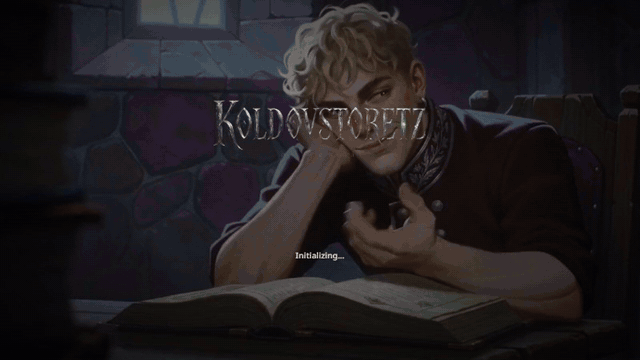
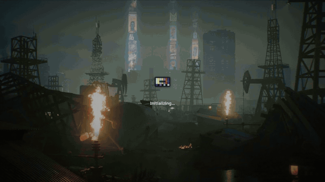
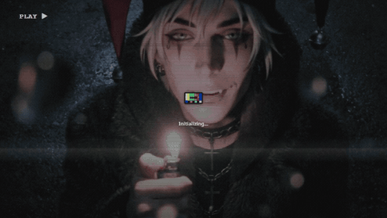
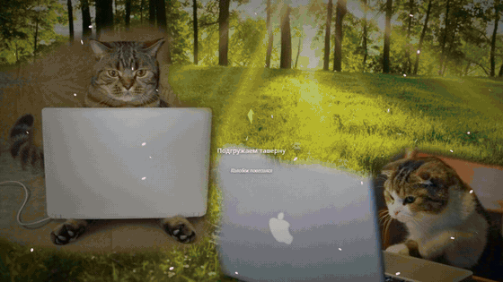
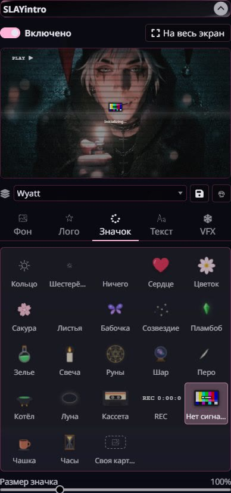
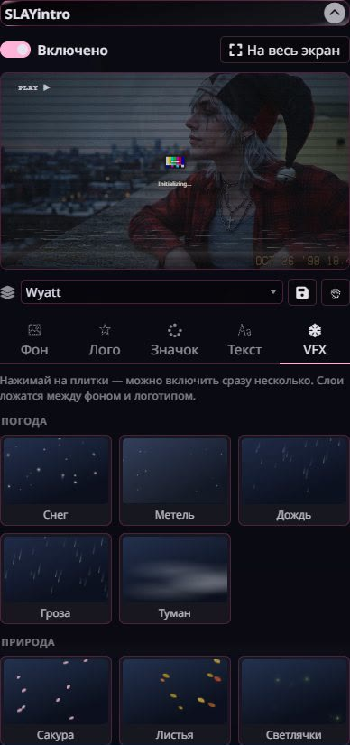

# SLAYintro

[English version](README.md)

Экран загрузки для [SillyTavern](https://github.com/SillyTavern/SillyTavern), как в играх. Вместо логотипа таверны и надписи «Инициализация» — ваш фон (картинка, видео или слайдшоу), ваш логотип, значок загрузки на выбор, подсказки и эффекты поверх: снег, дождь, искры, старая плёнка. Без музыки и без полоски прогресса: что-то крутится, пока таверна грузится.










 

*Тестовые варианты для беты, не финальный вид.*

Интерфейс настроек на русском.

## Установка

1. В таверне откройте **Расширения → Установить расширение**.
2. Вставьте адрес и подтвердите:

   ```
   https://github.com/wewwaistyping/SLAYintro
   ```

3. Обновите страницу.

Проверено на SillyTavern 1.19.0, на компьютере и на телефоне.

## Как это работает

Экран подменяется сам при каждом запуске таверны. Первую секунду после открытия вкладки таверна всё равно показывает свой стандартный экран: расширения включаются только после того, как она прочитает настройки, раньше вмешаться нельзя. Дальше экран ваш, до конца загрузки.

Настройки: **Расширения → SLAYintro**. Наверху живое превью, по клику открывается на весь экран. Все изменения видны сразу.

## Вкладки

| Вкладка | Что в ней |
|---|---|
| **Фон** | Фон темы, свой файл (картинка, GIF или видео) или слайдшоу из картинок с перемешиванием и настраиваемой сменой. Для картинок — лёгкая анимация: наезд, дрейф, дыхание. Затемнение. Отдельное лёгкое видео для телефонов |
| **Лого** | Логотип таверны, свой файл или ничего. Размер и анимация: парит, пульс, сияние |
| **Значок** | Значок загрузки: 23 на выбор или своя картинка |
| **Текст** | Надпись вместо «Инициализация» и подсказки, которые сменяют друг друга |
| **VFX** | Эффекты поверх фона, можно включить несколько сразу, у каждого своя сила |

## Сборки

Набор настроек можно сохранить как сборку и переключаться между ними в выпадающем списке. Изменения сразу сохраняются в выбранную сборку, об этом напоминает строка под списком. Чтобы сделать новую сборку, сначала нажмите дискету, а потом меняйте. Если нажать её уже после правок, расширение предложит вернуть старую сборку к прежнему виду. Корзина удаляет выбранную сборку.

## Значки загрузки

Кольцо, шестерёнка, сердце, цветок, сакура, листья, бабочка, созвездие, пламбоб (шесть цветов), зелье, свеча, руны, шар, перо, котёл, луна, кассета, REC, нет сигнала, чашка, часы — или совсем ничего.

**Своя:** PNG с прозрачностью, GIF, WebP или короткое видео, с анимацией на выбор: крутить, пульс, качать, парить, мерцать, монетка, прыгать.

## Эффекты

- **Погода:** снег, метель, дождь, гроза, туман.
- **Природа:** сакура, листья, светлячки, пылинки, пузыри.
- **Магия:** искры, волшебство, руны, звездопад, дым.
- **Плёнка:** VHS, старое кино, капли на стекле.
- **Свет:** виньетка, лучи.

Всё нарисовано кодом, картинок в расширении нет.

## Файлы

Загруженные картинки и видео сохраняются в `user/files` вашей таверны. Картинки перед загрузкой уменьшаются (фон до 1920 px, логотип и значок до 1024 px) и сжимаются в WebP. Видео загружается как есть; тяжелее 25 МБ расширение предупредит. В настройках хранятся только ссылки. Если убрать файл из настроек, в `user/files` он останется.

Видео лучше готовить заранее: без звука, 1080p или меньше, несколько мегабайт. Для телефонов можно загрузить отдельную лёгкую версию.

## Телефоны

На телефонах и планшетах расширение само облегчает экран: берёт лёгкое видео, если оно задано, а для тяжёлого видео без лёгкой версии показывает кадр из него с медленным наездом. Частиц в эффектах вдвое меньше, без размытия и свечения.

Как только таверна загрузилась, экран выгружается полностью: видео остановлено, таймеры сняты, ничего не крутится.

## Хорошо знать

- **Копия настроек.** Таверна сохраняет все настройки одним файлом из той вкладки, что сохранила последней. Если таверна открыта и на телефоне, и на компьютере, старая вкладка может откатить ваши сборки. Поэтому расширение держит свою копию в `user/files/slayintro-settings.json` и при запуске берёт ту, что новее.
- **Внешних запросов нет.** Расширение ничего не грузит из интернета.
- **Темы таверны** не меняются: экран рисуется поверх и исчезает.

## Лицензия

[AGPL-3.0](LICENSE).

Пламбоб и другие значки — фанатская стилизация. Названия игр и торговые марки принадлежат их владельцам, расширение с ними не связано.
